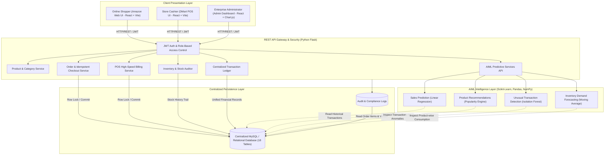
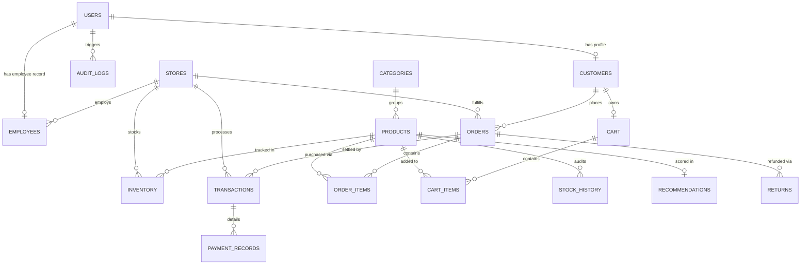

# SMARTFLOW: AI-POWERED RETAIL & E-COMMERCE MANAGEMENT SYSTEM
## Enterprise System Architecture Documentation (Phase 1)

---

### 1. Executive Summary & Vision

**SMARTFLOW** is an omnichannel retail and e-commerce transaction platform designed to unify two historically distinct retail paradigms into a single, cohesive software architecture:

1. **DMart-Style Physical Retail Operations**:
   - Ultra-fast Point-of-Sale (POS) barcode-based billing.
   - Physical store and shelf inventory tracking.
   - Cashier shifts, cash/UPI/card tender reconciliation.
   - Immediate stock deductions upon checkout confirmation.

2. **Amazon-Style Digital E-Commerce Operations**:
   - Web storefront with catalog browsing, hierarchical categories, and search filters.
   - Persistent customer shopping cart and promotional coupon redemption.
   - Idempotent order placement and simulated online payment processing.
   - Customer order lifecycle management (Pending -> Processing -> Shipped -> Delivered).

3. **Centralized Engine & Shared Core**:
   - **Unified Product Catalog**: Both store cashiers and online customers reference the same master SKU and pricing database.
   - **Centralized Inventory Management**: Real-time stock counts across multiple stores and centralized fulfillment warehouses with row-level locking to prevent overselling.
   - **Unified Transaction Ledger**: Every single financial settlement—whether from an online credit card payment or a DMart cash register—is recorded in a single auditable transaction table.
   - **AIML Analytical Intelligence**:
     - *Sales Prediction* (Linear Regression)
     - *Product Recommendations* (Popularity & Frequency-based)
     - *Unusual Transaction Detection* (Isolation Forest Anomaly Detection)
     - *Inventory Demand Forecasting* (Moving Average Restock Estimator)

---

### 2. High-Level System Architecture Diagram

---

### 3. Subsystem Breakdown

#### 3.1 DMart POS Subsystem
- **Target Audience**: Store Cashiers and Retail Shift Managers.
- **Key Characteristics**: Sub-second barcode/SKU lookup, keyboard navigation shortcuts, local store inventory verification, support for split payment methods (Cash, UPI, Card), instant printable receipt layout.
- **Inventory Concurrency**: Operates with strict transaction isolation to decrement local store inventory atomically upon checkout.

#### 3.2 Amazon Online Shopping Subsystem
- **Target Audience**: End-consumers and registered loyalty members.
- **Key Characteristics**: Fast catalog discovery, category filtering, search suggestions, shopping cart session management, coupon validation engine, simulated payment flow with idempotency protection against duplicate double-charges.
- **Inventory Concurrency**: Fulfillment drawn either from the primary central e-commerce hub or nearest regional store branch.

#### 3.3 Centralized Transaction & Order Engine
- Unified database tables: `orders`, `order_items`, `transactions`, `payment_records`.
- `orders.order_type` differentiates `'ONLINE'` vs. `'STORE'` while retaining identical financial, discount, and tax structures.
- Idempotency key guarantee: Rapid successive clicks on "Place Order" or "Complete Bill" are deduplicated via unique idempotency hashes.

#### 3.4 AIML Intelligence Engine
- **Feature 1 (Sales Prediction)**: Analyzes time-series transaction aggregations using Linear Regression to estimate daily/weekly sales volumes.
- **Feature 2 (Product Recommendations)**: Computes popularity rankings and category correlations to recommend trending items on the customer storefront.
- **Feature 3 (Unusual Transaction Detection)**: Evaluates transaction amounts, velocities, and tendered payment distributions using Scikit-Learn's `IsolationForest` to flag statistical outliers for admin auditing without blocking legitimate users.
- **Feature 4 (Inventory Demand Prediction)**: Computes moving averages (7-day / 30-day windows) over consumption history to alert store managers before critical safety stock depletion.

---

### 4. Database Schema Structure (18 Tables)

1. **`users`**: Base credentials, passwords (hashed), role (`ADMIN`, `CUSTOMER`, `EMPLOYEE`).
2. **`customers`**: Customer full name, address, phone, aggregated lifetime spend.
3. **`employees`**: Staff code, store allocation, job role, cashier shift.
4. **`stores`**: Multi-store branches (Hub, Andheri DMart, Whitefield DMart, etc.).
5. **`categories`**: Product classifications (Groceries, Electronics, Apparel, Home).
6. **`products`**: Central master catalog with SKU, barcode, MRP, and selling price.
7. **`inventory`**: Store-wise physical stock quantity, safety stock, reorder levels.
8. **`stock_history`**: Audit trail of stock additions, store sales, online sales, and damage write-offs.
9. **`orders`**: Master order headers with `order_type` (`ONLINE` / `STORE`), status, and totals.
10. **`order_items`**: Line items detailing quantity, unit price, and subtotal.
11. **`transactions`**: Unified financial settlement ledger with anomaly detection flags.
12. **`payment_records`**: Simulated payment gateway references and transaction status.
13. **`cart`**: Active customer e-commerce cart.
14. **`cart_items`**: Individual product line items in customer cart.
15. **`coupons`**: Discount promo codes with expiry, minimum order thresholds, and caps.
16. **`returns`**: Product returns, inspection status, and refund transactions.
17. **`recommendations`**: Pre-calculated AI recommendation ranks and popularity scores.
18. **`audit_logs`**: System audit trail capturing user ID, action, target entity, and timestamp.

---

### 5. Phase 1 Verification Checklist

- [x] Full folder structure established (`frontend/`, `backend/`, `aiml/`, `database/`, `tests/`, `docs/`).
- [x] Environment configuration templates (`.env.example`, `.env`, `.gitignore`).
- [x] Production-grade MySQL DDL script (`database/schema.sql`) covering all 18 tables with primary keys, foreign keys, and indexes.
- [x] SQLAlchemy ORM Models defined across modular packages in `backend/app/models/`.
- [x] Flask Application Factory initialized (`backend/app/__init__.py`) with JWT, CORS, connection pooling, and resilient SQLite development fallback.
- [x] CLI Runner & Database Initializer (`backend/run.py`).
- [x] Database Diagnostic Suite (`database/test_db_connection.py`) verifying all 18 tables live.
